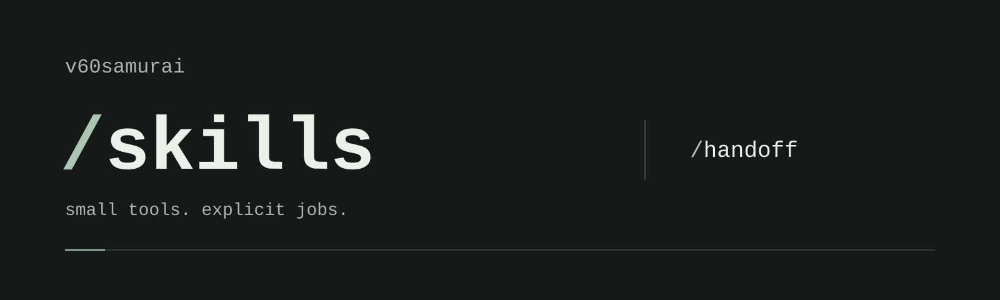

<p align="center">
  
</p>

# Skills

Claude Code skills I wrote and use. Each one does a single job that I was otherwise re-explaining in every session, and none of them plans, routes, or decides what the work means.

## Published

| Skill | What it does | Invocation | Status |
| --- | --- | --- | --- |
| [`handoff`](skills/handoff/SKILL.md) | Compiles meeting notes, Granola meetings, screenshots, threads, specs and updates into one self-contained Markdown file. Noise goes, material detail stays. A proposal stays a proposal, a disagreement stays visible, and secrets stay out. Inside a Git repository it reads the project's status quo first. When no spec matches, the file opens with an execution contract, a specification and tickets that PStack can build from, derived from the evidence and approved by you. Images are stored beside the file. | `/handoff` | portable, explicit only |

[`catalog.json`](catalog.json) lists every skill I have written, including the ones that live elsewhere: in their own repositories, or inside a larger system they depend on. Each entry says where the skill lives and why its source is not copied here.

## Principles

- **Smallest sufficient machinery.** A skill is a Markdown file until it needs to be more.
- **One job, one owner.** `/handoff` packages evidence. Whoever receives it decides what the evidence means.
- **Evidence before invention.** A skill reports what the source says and marks what it does not say.
- **One router at most.** These skills never choose a playbook, a milestone, or the next skill.
- **The human moves work between stages.** A skill calls the next one only when the invocation asks for that in words.

## Install

A skill is a directory with a `SKILL.md`. Claude Code loads personal skills from `~/.claude/skills/<name>/`.

```bash
git clone https://github.com/v60samurai/skills.git
ln -s "$PWD/skills/skills/handoff" ~/.claude/skills/handoff
```

Copy the directory instead of linking it if you would rather not track this repository. Then type `/handoff` in Claude Code, followed by the material:

```text
/handoff <paste notes, a thread, or file paths>
/handoff --inline <material>
/handoff --evidence-only <material>
/handoff --candidate <material>
/handoff save it to docs/handoffs/pricing.md <material>
```

Inside a Git repository the first form writes one Markdown file, plus a folder of its images, and prints a receipt. Before writing, it shows you the tickets and the open decisions and asks you to approve the contract. `--evidence-only` writes the evidence alone, as earlier versions did. `--candidate` skips the review and writes the contract unapproved. `--inline` prints the handoff in chat and writes nothing. An explicit path wins over the storage rule.

`handoff` sets `disable-model-invocation: true`, so it runs only when you type it.

## How `/handoff` works

`/handoff` is not a summary. It compiles messy human context into one file a fresh agent can build from, and keeps the evidence that justifies every line of it.

```text
                          no spec matches:  A. execution contract
MESSY CONTEXT -> /handoff ----------------> B. specification       -> PStack
                                            C. tickets
                                            D. evidence
                          a spec matches:   evidence only          -> spec writers -> PStack
```

The evidence records what was said, what exists, what was observed and what was proposed. When no spec matches, Parts A to C are derived from it: the objective and scope, the approved and open decisions, the expected behavior, and tickets that are each a vertical slice with its blockers, acceptance criteria, proof and the statements it rests on. A ticket is READY only when every decision that could change it is approved. Parts A to C stay a candidate until you approve them in the run, and the file tells PStack to build only from an approved contract. When a spec matches, the handoff stays evidence only, and the spec writers decide what is authoritative there.

It removes noise without removing material context: repetition and chatter collapse, and every distinct requirement, roadmap phase, implementation step, contract, testing expectation, dependency and open question stays.

- **A file by default.** Inside a Git repository the handoff is written to disk. When you or the source name a spec, or the source adds to a handoff stored in one, it goes to `specs/<id>/handoffs/H<nnn>-<YYYY-MM-DD>-<slug>.md`, numbered after every H number the spec has used and never reusing one. When the source only shares a spec's subject, the skill asks whether to file it into that spec as evidence, the recommended answer, or to write tickets outside the spec. Being the only spec in the repository does not make it a match. When two specs match about equally, the skill asks which one. When no spec matches, the handoff goes to the intake directory, `handoffs/<YYYYMMDD-HHMMSS>-<slug>.md`, and the first spec writer that takes in an evidence-only file there files it under a spec. The header records which of these was established. Outside a repository, with no path given, there is nowhere to write, so the handoff is printed.
- **A header from commands.** The file opens with plain `Label: value` lines: handoff id, created time, repository, branch, full baseline revision, working tree, depth, mode, previous handoff, spec, sources and their hashes, material information loss, `Evidence complete`, `Contract` (approved with your words, candidate, or none), `Execution ready` (which tickets are READY) and `Assets`. Each value comes from command output in that run, or from the review.
- **A receipt in chat.** Path, depth, baseline, mode, material information loss, the verdict, and the next command. `Evidence complete: YES` means the file is self-contained. It says nothing about engineering readiness.
- **Adaptive depth.** The skill picks the depth from how much unique consequential material the source holds, not from its length. SMALL: one update or decision. STANDARD: a meaningful feature or update. DEEP: several systems, architecture, a roadmap or an implementation sequence, which can run to several thousand words.
- **Self-containment.** A fresh session with only the repository and the file path must not need the original chat, notes or document. References supplement the handoff and never stand in for content. If the source points at material that was not supplied, the handoff says so and its verdict is `Evidence complete: NO`.
- **Status quo first.** Inside a Git repository the skill does a bounded pass before writing, read-only except for the handoff file: branch, revision, working tree, project documents, existing specs, and the code on the surfaces the source touches. The handoff reports the source as a delta against the committed baseline: what already exists, what is new, what conflicts. Uncommitted local changes are kept apart. What the code does is evidence, not approval.
- **Two checks before writing.** Check A asks what the receiver would still have to recover from the original source. Check B asks whether the handoff decided anything a spec writer should reconcile. Both must pass.
- **Evidence and execution kept apart.** The evidence holds no tickets, readiness states or plans of its own. Tickets and their states live only in Parts A to C, cite the evidence by id, and never choose a PStack playbook, model, worker or file edit. A source's own roadmap or plan is carried in the evidence under its own names, labelled as the source's.
- **Images kept.** Screenshots from Granola meetings, pasted images and image files are copied into `<Handoff id>-assets/` beside the file, hashed, and listed under Images. What each one shows that matters is also written as statements, so a reader who never opens the image loses nothing. A screenshot that shows a secret is not stored.
- **A check script.** `skills/handoff/scripts/check-handoff.mjs` runs before the file is written. It checks the parts, the S, E and T ids, every citation, each ticket's fields and blockers, the readiness and assets headers against the body, and each stored image's hash.

For a new project handoff, start from a clean default branch:

```bash
cd <project>
git status
claude
```

```text
/handoff <material>
```

With an approved contract, start PStack on the file: `/pstack:poteto-mode build handoffs/<file>.md`. For an evidence-only handoff, give its path to the spec writer it concerns, usually `prd-writer` first. `/handoff` stops after the receipt.

## Structure

```text
skills/<name>/SKILL.md   one directory per published skill
catalog.json             every first-party skill and where it lives
tests/handoff/           source fixtures, repository fixtures, property checks, and a runner
assets/                  banner
```

`node tests/handoff/run.mjs` runs each fixture through `/handoff` with `claude -p` and checks properties of the result: an exact value survived, a proposal was not promoted to a decision, every roadmap phase kept its own entry, a repetitive transcript came out shorter than a dense spec, no statement was made twice, a handoff landed in a spec's store only when that spec matched the source, no secret leaked, nothing was written in inline mode or outside a repository with no path given, and inside a repository the one handoff file was the only change to Git state.

## Attribution

The source in this repository is original work under the [MIT license](LICENSE). Skills adapted from someone else's work are credited in `catalog.json` and their source is not republished here. The banner was designed by Codex.
